# Pensum interactivo — Cambios de la revisión del 29 de octubre

**Fecha:** 3 de noviembre de 2026
**Alcance:** todo lo acordado en la reunión del 29 de octubre y en el correo de ese mismo día, más el nuevo acceso para asistentes de IA (sección 12).

Todas las capturas son de la aplicación funcionando con la carga oficial de 2027-1 (plan de Electrónica).

---

## 1. Carga oficial de los Excel del departamento

La aplicación ahora se alimenta directamente de los tres archivos oficiales: **PLANES**, **BOLSAS** y **PRERREQUISITOS**. Ya no hace falta la cartelera: los requisitos del periodo indican qué se dicta.

- **Nueva sección "Carga oficial" en el administrador.** Se suben los tres archivos, se indica para qué periodo es la planeación y se revisa un informe completo antes de aplicar. Antes de cada carga se guarda una copia de seguridad, y los ajustes manuales del administrador se respetan.
- **PLANES:** cada columna es un plan. Los laboratorios quedan como correquisitos de su materia, y las electivas de 4 créditos se muestran como dos casillas de 2.
- **BOLSAS:** cada programa tiene su propia clasificación (obligatoria, electiva o integrador). La columna PROXIMO se muestra como "Próxima oferta proyectada", "Se dicta todos los semestres" o "Por definir".
- **PRERREQUISITOS:** se usan los requisitos del periodo declarado. Las restricciones del tipo "Excluye ingresa a N semestre" se traducen a créditos aprobados (15 × N), y se respetan las restricciones por programa y por nivel.
- **El plan quedó actualizado con 2027-1:** CCOM 1100, IELE 2110, MATE 2301 e IELE 3018 reemplazan a las casillas genéricas o a los códigos anteriores, y Electrónica análoga aparece con su código correcto (IELE 3200).

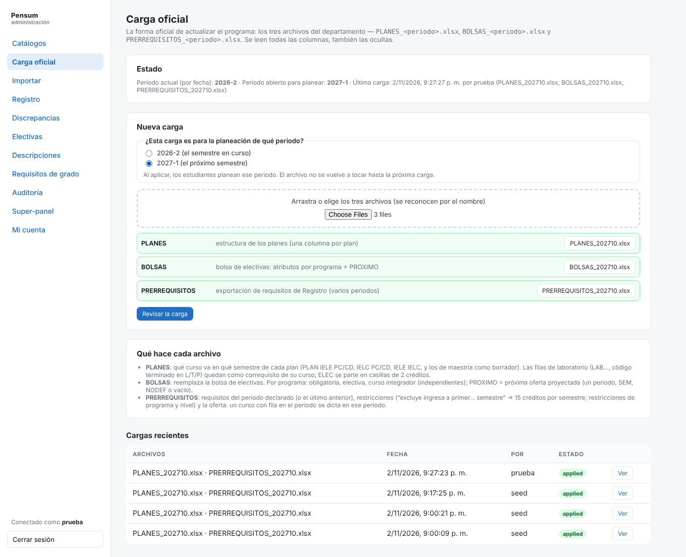

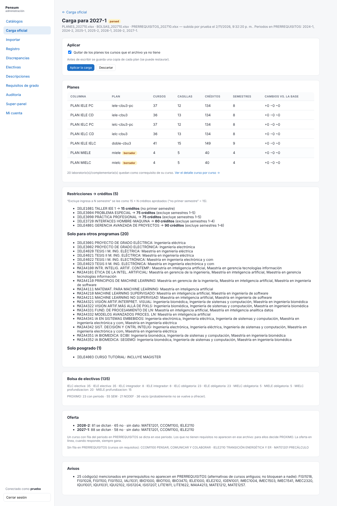

---

## 2. Avisos en la canasta

- **Aviso antes de agregar:** si al estudiante le falta un requisito, aparece un aviso ámbar ("Ojo: no has aprobado…"). Puede agregar la materia igual.
- **Resumen al revisar la canasta:** un recuadro naranja arriba lista cada materia y lo que le falta, en todos los pasos.
- **Correquisitos:** si se retira de la canasta un correquisito, la materia que lo necesita queda marcada.

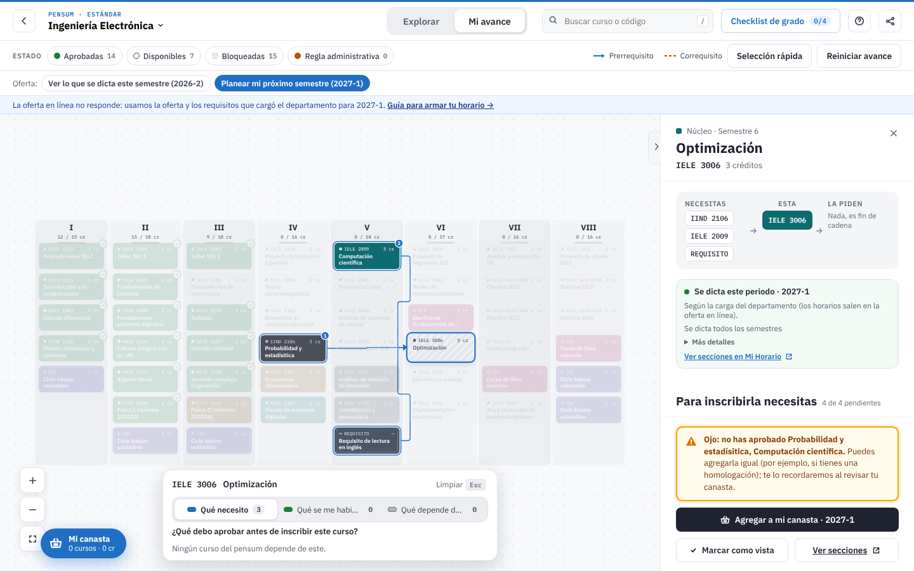

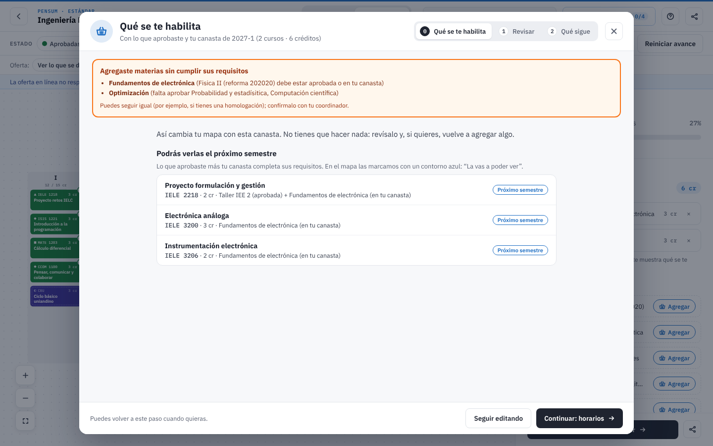

---

## 3. Próximo semestre marcado en vivo

- Al agregar una materia a la canasta, el mapa marca de inmediato, con un borde azul ("La vas a poder ver"), las materias que se desbloquean el semestre siguiente. Al retirarla, la marca desaparece.

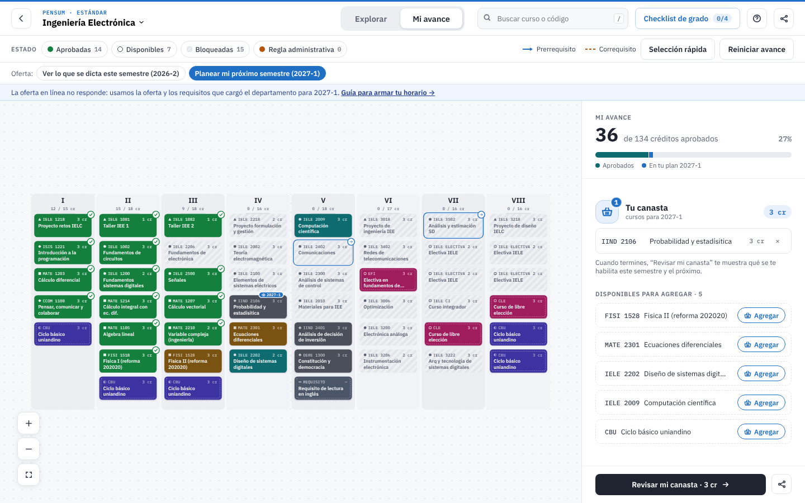

---

## 4. Electivas como una sola bolsa

- **Todas las casillas de electiva funcionan como una sola bolsa.** Las materias se acomodan en orden y pueden ocupar casillas partidas, por ejemplo una de 3 créditos ocupa 1½ casillas. Se indica con "(cont.)" y "1 cr libre".
- **Créditos de más:** si el estudiante supera los créditos de electivas del plan, se le avisa que el excedente puede contar como CLE.
- **Al retirar una electiva**, las siguientes se reacomodan solas.
- **La canasta guarda la materia, no la casilla.** Para reservar una electiva sin nombre se usa "Agregar electiva sin especificar", que pregunta los créditos.

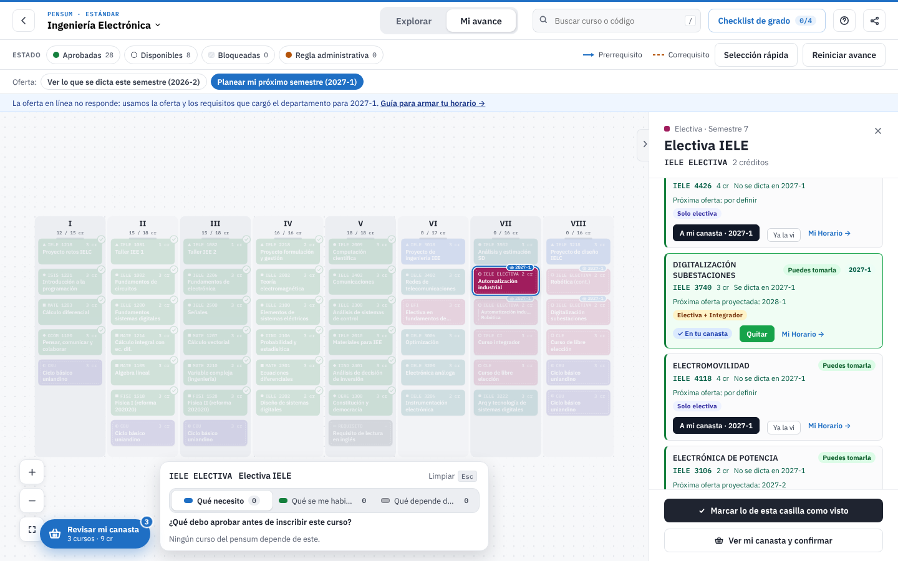
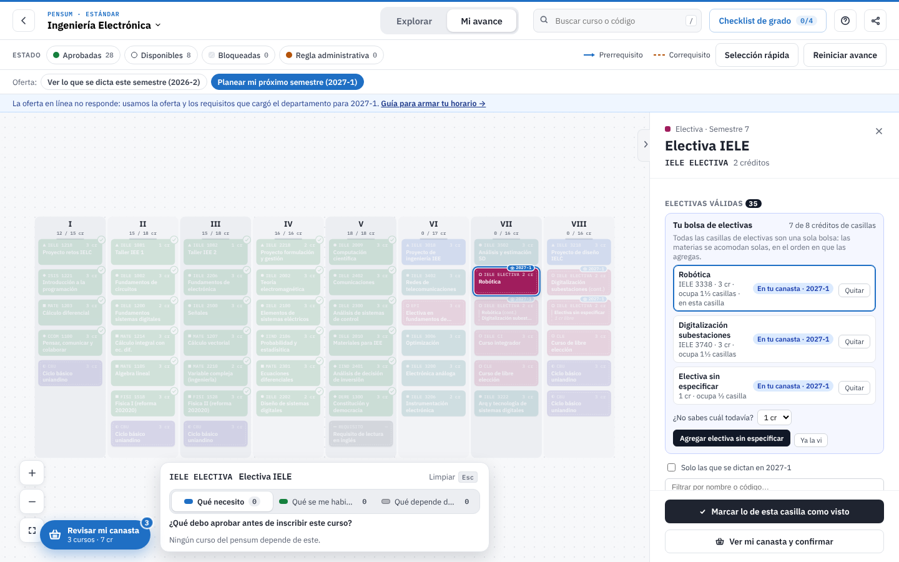

---

## 5. Selector de electivas

Nueva versión de la página insertable de electivas (`/embed/electivas`), pensada para el sitio del departamento:

- **Barra resumen a escala:** con ambos programas, cuántas electivas son comunes y cuántas son propias de cada uno; con un solo programa, cuántas son solo electiva, electiva + integrador o solo integrador. Cada parte de la barra filtra la lista.
- **Tabla de roles:** una fila por materia, con ● electiva y ◆ integrador para cada programa. Donde una materia no aplica se muestra "no aplica" en gris punteado, nunca en rojo.
- **Columna "Se dicta":** verde para el periodo actual o el siguiente, ámbar para el periodo proyectado y gris para "por definir".
- **Filtros** por programa, tipo (electivas o integradores) y periodo, más un buscador.
- **Detalle de cada materia** (requisitos, última y próxima oferta) y botón "Planear con esta materia".
- Se adapta al ancho disponible, incluso en celular, para poder insertarlo en el sitio del departamento.

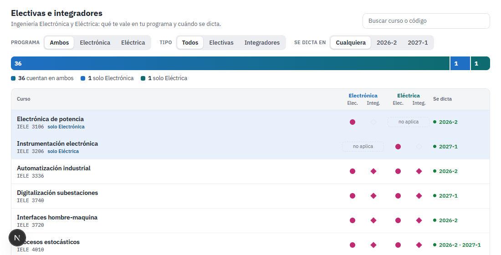
Electivas (Computador)
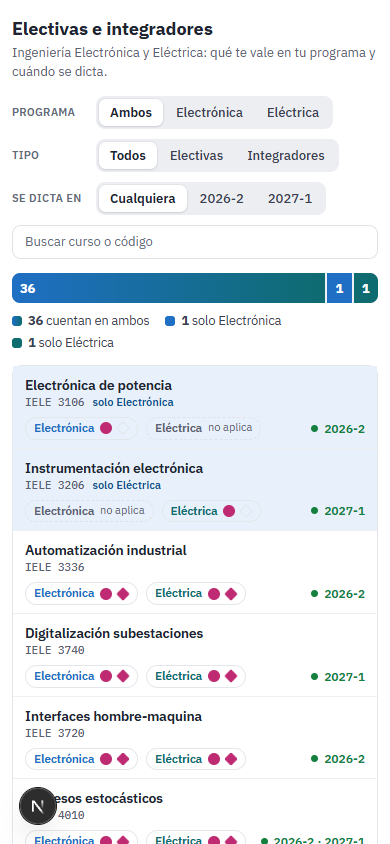
Electivas (Celular)

---

## 6. Correcciones del correo del 29 de octubre

- **"Diseño de líneas cargaba una materia de ISIS":** las electivas ahora se identifican por código y no por nombre, así que ya no hay cruces.
- **"En 'aún no', mostrar los prerrequisitos":** cada electiva bloqueada muestra "Necesitas: …" sin tener que abrirla.
- **"Una materia de FISI entre las electivas":** no está en la bolsa oficial, así que ya no aparece.

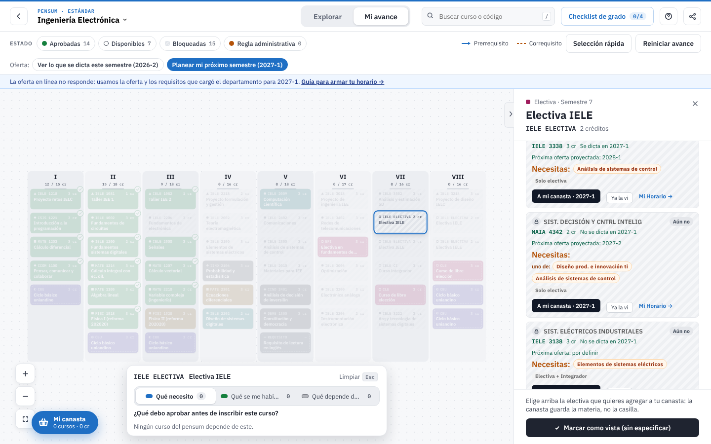

---

## 7. Habilitación de materias

- Las restricciones de créditos se aplican con los requisitos nuevos. Por ejemplo, Taller IEE 1 pide 15 créditos ("no primer semestre") e Interfaces hombre-máquina pide 60.
- Las materias de maestría que solo pueden tomar algunos programas ya no aparecen como "Puedes tomarla".
- Mientras se consulta la oferta aparece "Cargando la oferta de 2027-1…", en lugar de una lista que parece toda bloqueada.

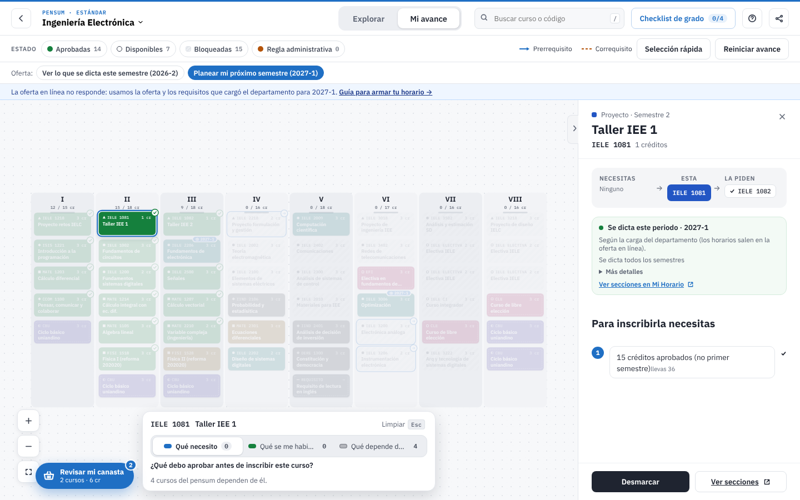

---

## 8. Mapa: grupos y colores del PDF del pensum

- **El grupo de cada materia se toma de la columna TIPO de PLANES.** Sirve tanto con los cuatro valores que usa hoy el archivo (Obligatorio, Proyecto, Electiva, CBU) como con las siete categorías del PDF del pensum (Fundamentos de Ingeniería, Fundamentos Transversales IEE, Fundamentos Específicos, Ciclo Terminal, Ciclo de Ciencias y Matemáticas, Proyectos, Educación General).
- **Los colores son los del PDF**, oscurecidos solo lo necesario para que el texto se lea bien. Cada grupo tiene además un símbolo propio.
- La leyenda y los filtros muestran solo los grupos que tiene el plan, con los nombres del archivo.
- El grupo también se puede editar desde el administrador.

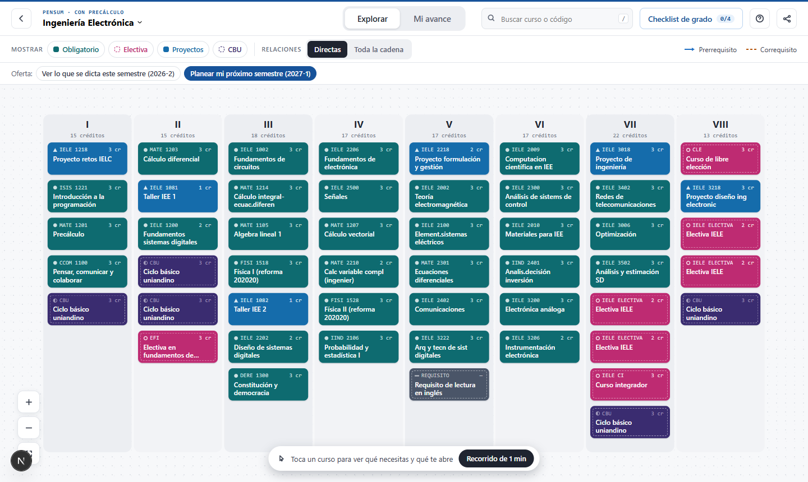

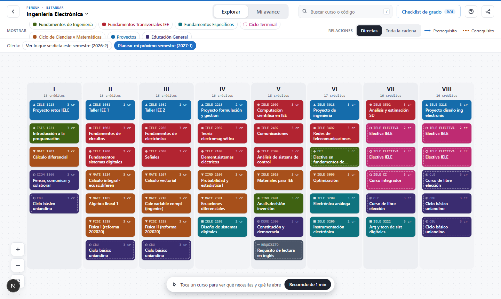

*La segunda captura es una vista previa con las categorías del PDF escritas en la columna TIPO.*

---

## 9. Mi avance y la canasta

- **Nuevos filtros de estado:** Aprobadas · Disponibles · Canasta · Desbloqueadas con canasta. Al elegir uno o varios, el mapa resalta solo esas materias.
- **"Revisar mi canasta" queda siempre visible** abajo a la izquierda cuando la canasta tiene algo, en cualquier vista.

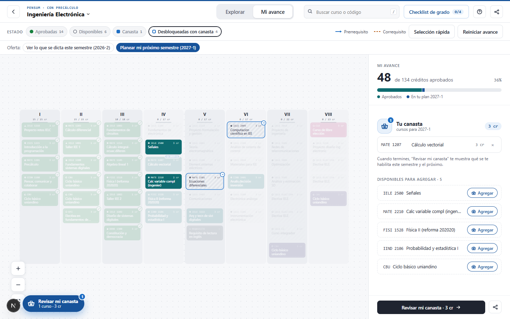

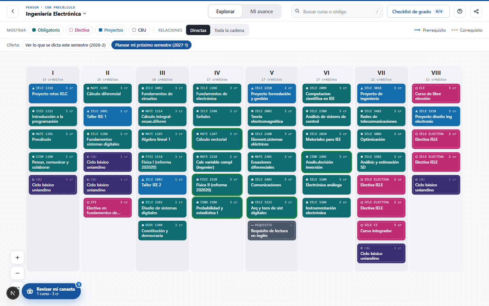

---

## 10. Selección rápida

- **La pregunta ahora es "¿Qué semestres ya terminaste?"** en todas las entradas. Se puede elegir semestre por semestre (no tienen que ser seguidos) o usar el atajo "del I al N".
- **La animación de "materia desbloqueada"** ahora aparece solo en las materias que de verdad quedan disponibles.

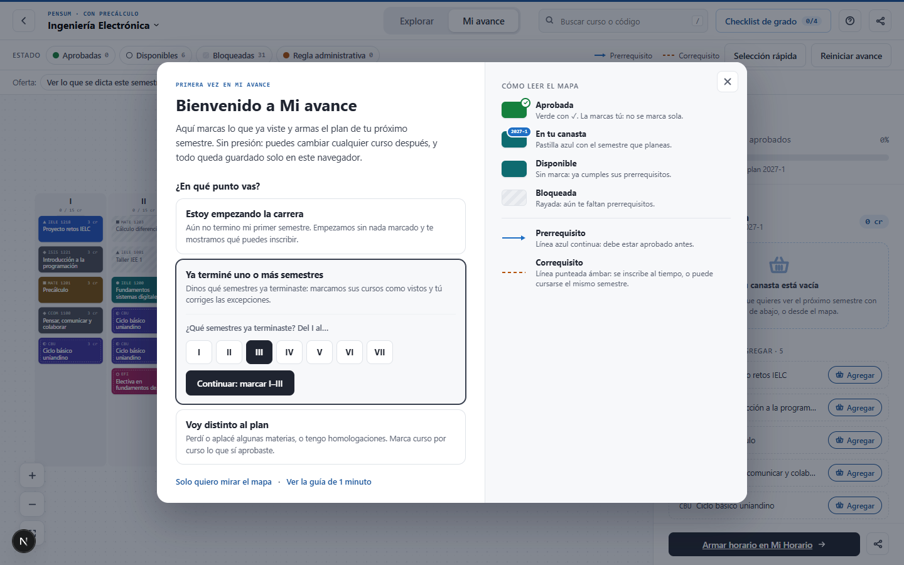

---

## 11. Otras mejoras

- **Requisito de escritura en español:** Fundamentos de electrónica ya no muestra por error "lectura en inglés". El grupo ahora dice "Requisito de escritura en español · uno de estos".
- **CLE (curso de libre elección):** mejor explicación en el panel lateral. Sus créditos cuentan para el total del plan.
- **Próxima oferta** visible en todas las materias; la última vez que se dictó queda en "Más detalles".
- **Contraste:** todos los colores del mapa cumplen la norma de legibilidad (mínimo 4.5:1).
- **Periodo actual y siguiente:** el estudiante puede alternar entre "Ver lo que se dicta este semestre (2026-2)" y "Planear mi próximo semestre (2027-1)".
- **Respaldo si la API de cursos falla:** la aplicación sigue funcionando con los datos de la carga oficial y muestra un aviso azul.
- **Nueva página "Planeación":** reúne el selector de electivas, el planeador y el Genially, cada uno con la opción "Abrir en grande".
- **Inicio de sesión del administrador:** ahora funciona aunque la contraseña se pegue con un espacio o salto de línea al final.

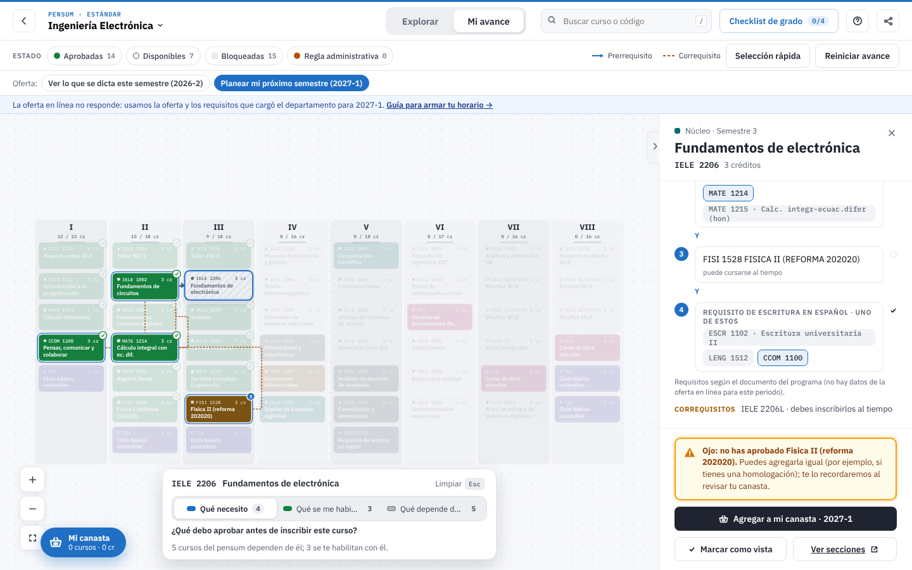

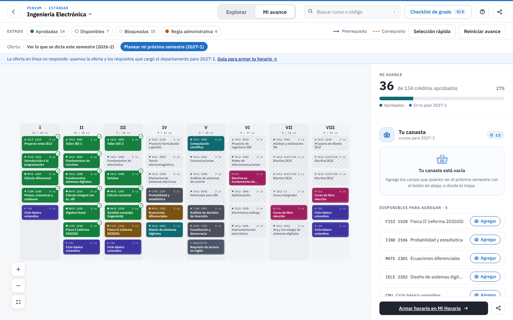

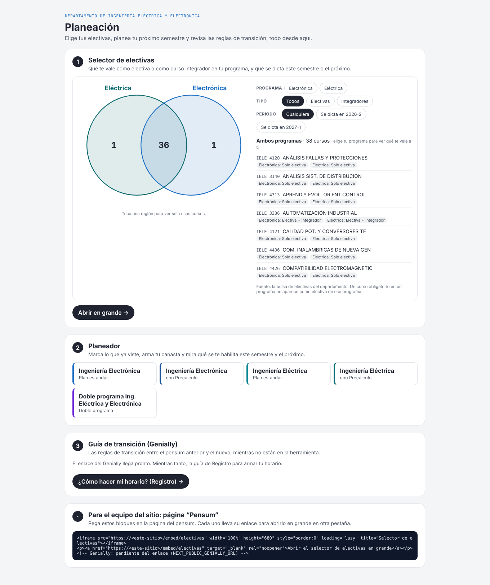

---

## 12. Edición de requisitos desde un asistente de IA (MCP)

Los administradores ahora pueden conectar un asistente de IA (Claude en la web o en el escritorio, Google Antigravity o Claude Code) para **consultar y editar los prerrequisitos y correquisitos** de las materias, en su nombre y con lenguaje natural.

- **Alcance limitado:** el asistente solo ve y cambia requisitos de materias. No puede tocar usuarios, cargas, la estructura de los planes ni el super-panel.
- **Qué puede hacer:** buscar materias, ver sus requisitos en cada plan (lo que dice el documento, lo que dice la API y lo que ve el estudiante), cambiar prerrequisitos o correquisitos y listar las diferencias con la API.
- **Pide confirmación cuando hay conflicto con la API:** si el valor nuevo no coincide con el de la API, no guarda nada y muestra la diferencia para que el administrador decida:
  - **Reemplazar la API:** los estudiantes ven el valor del administrador.
  - **Guardar solo como respaldo:** los estudiantes siguen viendo la API mientras tenga datos.
- **Protección contra errores:** rechaza textos mal escritos, una materia que se pide a sí misma y prerrequisitos circulares. Avisa si un código no existe en la base de datos.
- **Todo queda registrado** en la bitácora de auditoría, a nombre del administrador dueño del acceso.
- **Llaves de acceso personales:** cada administrador las crea en **Mi cuenta → Acceso para asistentes (MCP)**, con nombre y vencimiento, y las puede revocar en cualquier momento. La aplicación muestra las instrucciones de conexión para cada asistente.
- **También en el editor de cursos:** los correquisitos ahora se pueden editar, y cada requisito tiene una casilla para reemplazar la API.
- En el informe de **Discrepancias**, estos casos aparecen con el nuevo estado "Reemplaza a la API".
